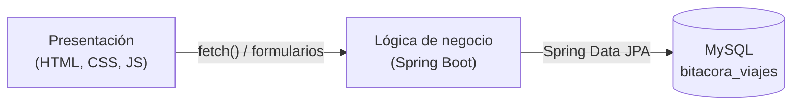
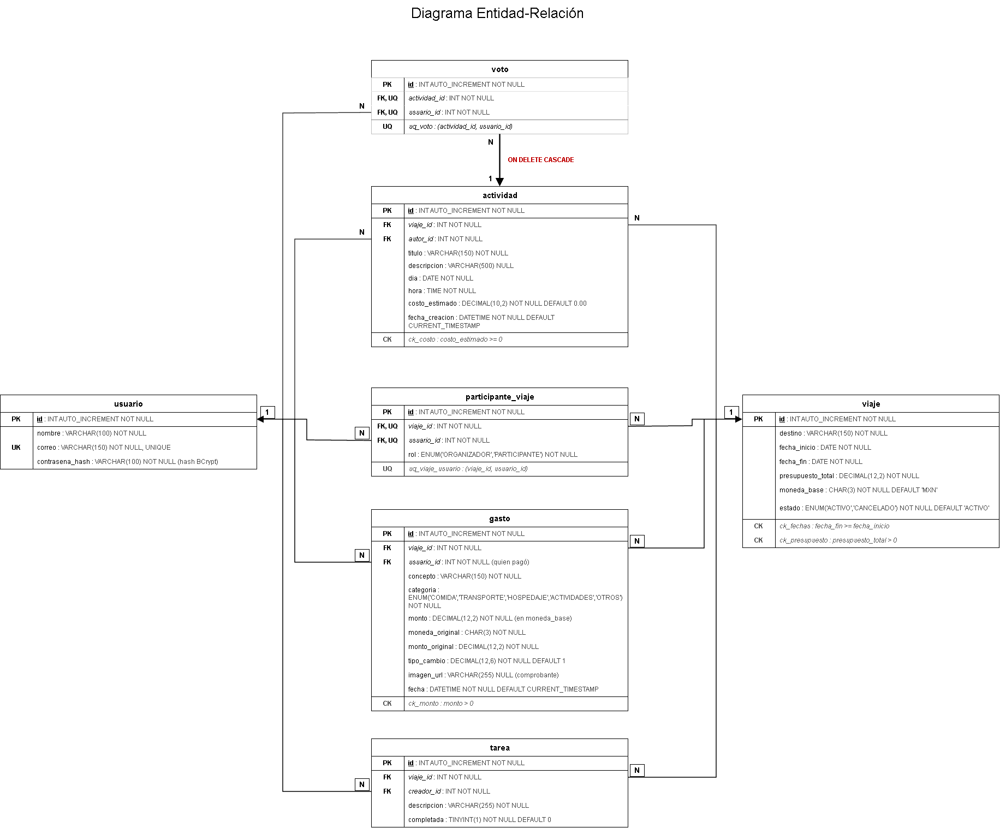

# Bitácora de viajes colaborativa

Aplicación web para organizar viajes en grupo: itinerario por días, votación de actividades y control de presupuesto y gastos, todo en un solo lugar.

## ¿Qué problema resuelve?

La planeación de un viaje en grupo termina dispersa en chats, notas y capturas; las decisiones las toman quienes más hablan y nadie sabe cuánto se ha gastado ni cuánto le toca a cada quien. Esta plataforma centraliza:

- **Itinerario** por días del viaje.
- **Votación** de actividades (la más votada de cada día se calcula automáticamente).
- **Presupuesto** total y por persona, gastos y balance de deudas del grupo.

## Tecnologías y arquitectura (3 capas)

| Capa              | Tecnología                                                                  |
| ----------------- | --------------------------------------------------------------------------- |
| Presentación      | HTML, CSS y JavaScript (Thymeleaf + `fetch()` para actualizar sin recargar) |
| Lógica de negocio | Java 17 + Spring Boot 3.2.5 (Web, Validation, Security)                     |
| Acceso a datos    | Spring Data JPA + MySQL                                                     |

El navegador se comunica con el backend mediante `fetch()` y formularios; el backend expone la API REST, aplica las reglas de negocio y accede a la base por medio de JPA.



## Equipo

- **Alfonso Mendoza Vasquez**
- **Dana Carmona Santamaria**
- **Diego Rafael Jimenez Trujano**
- **Stephanie Elizdeth Hernandez Prieto**
- **Citlaly Morales Viveros**

## Estructura del repositorio

```
desarrollo-web/
├── backend/          Proyecto Spring Boot (Maven)
├── frontend/         CSS y JavaScript
├── database/         Esquema SQL de referencia
├── documentacion/    Guías, API, diagramas y reportes
└── README.md
```

## Requisitos

- Windows 10 u 11 con WSL 2 y Ubuntu.
- JDK 17 o superior.
- Maven.
- MySQL 8.
- Git.
- curl, para probar la API REST desde la terminal.

Instalación en Ubuntu:

```bash
sudo apt update && sudo apt install -y openjdk-17-jdk maven mysql-server git curl
java -version
```

La guía completa está en `documentacion/guia-instalacion-wsl.md`.

**MySQL no arranca solo en WSL.** Antes de ejecutar la aplicación, inicia el servicio:

```bash
sudo service mysql start
```

## Base de datos

Entra a MySQL como administrador:

```bash
sudo mysql
```

Dentro de la consola, ejecuta los siguientes comandos y reemplaza `TU_USUARIO` y `TU_CLAVE` por los datos que elijas:

```sql
CREATE DATABASE IF NOT EXISTS bitacora_viajes CHARACTER SET utf8mb4 COLLATE utf8mb4_unicode_ci;
CREATE USER 'TU_USUARIO'@'localhost' IDENTIFIED BY 'TU_CLAVE';
GRANT ALL PRIVILEGES ON bitacora_viajes.* TO 'TU_USUARIO'@'localhost';
FLUSH PRIVILEGES;
EXIT;
```

El nombre de la base debe ser `bitacora_viajes` para todo el equipo. El usuario y la clave son de cada integrante y deben coincidir con los datos de `application.properties`.

Las tablas se crean con el archivo `database/esquema.sql` antes del primer arranque (ver sección Ejecución). Hibernate no puede crear `actividad` ni `gasto` en MySQL 8 (`Invalid default value for 'fecha_creacion'`).

El diseño completo está en `documentacion/diseño-base-datos.md` y el diagrama entidad-relación en `documentacion/evidencias/diagrama-er.png`:



Las 7 tablas del sistema:

| Tabla                | Guarda                                                                       |
| -------------------- | ---------------------------------------------------------------------------- |
| `usuario`            | Cuentas: nombre, correo único y contraseña con hash                          |
| `viaje`              | Destino, fechas, presupuesto total y moneda base                             |
| `participante_viaje` | Relación N:M entre usuarios y viajes, con rol (`organizador`/`participante`) |
| `actividad`          | Propuestas del itinerario: título, día, hora y costo estimado                |
| `voto`               | Un voto por persona por actividad                                            |
| `gasto`              | Concepto, categoría, monto en moneda original y tipo de cambio               |
| `tarea`              | Checklist del viaje y si está completada                                     |

## Clonar el repositorio

Clona el repositorio dentro de WSL, no en `/mnt/c`:

```bash
cd ~
git clone git@github.com:Peps06/desarrollo-web.git
cd desarrollo-web/backend
```

Si no tienes una llave SSH configurada en GitHub, clona con HTTPS:

```bash
git clone https://github.com/Peps06/desarrollo-web.git
```

## Configuración local

El archivo de configuración se crea a partir de la plantilla. Ambos comandos se ejecutan desde la carpeta `backend`:

```bash
cd ~/desarrollo-web/backend
cp src/main/resources/application.properties.example src/main/resources/application.properties
```

Abre `src/main/resources/application.properties` y cambia estas dos líneas:

```properties
spring.datasource.username=TU_USUARIO
spring.datasource.password=TU_CLAVE
```

Las demás propiedades pueden quedar como están. El archivo `application.properties` no se sube a GitHub, porque está en `.gitignore`. Solo se versiona la plantilla `application.properties.example`.

## Ejecución

Antes del primer arranque, crea las tablas desde la carpeta `backend` (la base debe estar vacía):

```bash
mysql -u TU_USUARIO -p < ../database/esquema.sql
```

Ejecuta la aplicación desde la carpeta `backend`:

```bash
chmod +x mvnw
./mvnw spring-boot:run
```

En la primera ejecución Maven descarga las dependencias, lo que puede tardar varios minutos. Cuando la aplicación arranca, la consola muestra `Started BitacoraViajesApplication`.

La aplicación queda disponible en `http://localhost:8080`.

## Qué debe funcionar

Antes de dar por terminada una parte del proyecto, revisa lo siguiente:

- La aplicación arranca sin errores y la consola muestra `Started BitacoraViajesApplication`.
- La base `bitacora_viajes` contiene las 7 tablas: `actividad`, `gasto`, `participante_viaje`, `tarea`, `usuario`, `viaje` y `voto`.
- Los datos de prueba se cargan solo la primera vez, aunque la aplicación se reinicie.
- El registro de usuario crea cuentas nuevas y rechaza correos repetidos y contraseñas de menos de 8 caracteres.
- Las contraseñas se guardan como hash BCrypt, nunca en texto plano.
- El inicio de sesión funciona con datos correctos y responde con error genérico con datos incorrectos.
- Las rutas de la API responden 401 cuando no hay sesión, y las páginas de viajes redirigen a `/login`.
- El cierre de sesión invalida la sesión actual.

## Verificación de la base de datos

En una segunda terminal de WSL:

```bash
mysql -u TU_USUARIO -p bitacora_viajes -e "SHOW TABLES;"
mysql -u TU_USUARIO -p bitacora_viajes -e "SELECT COUNT(*) AS usuarios FROM usuario;"
```

Deben aparecer 7 tablas. El conteo de usuarios debe ser `2` si solo se han cargado los datos de prueba.

## Datos de prueba

Al arrancar por primera vez, la aplicación carga datos de prueba si la base de datos no tiene usuarios. Si reinicias la aplicación, no se vuelven a cargar.

| Dato        | Contenido                                                                                        |
| ----------- | ------------------------------------------------------------------------------------------------ |
| Usuarios    | `ana@example.com` (organizadora) y `luis@example.com` (participante). Contraseña: `Password123`  |
| Viaje       | Oaxaca, del 20 al 27 de diciembre de 2026, presupuesto de 15,000.00 MXN                          |
| Actividades | Visita a Hierve el Agua (2 votos) y Cena en el Mercado 20 de Noviembre (1 voto)                  |
| Gastos      | Hospedaje de 4,500.00 MXN y taller de cerámica de 30.00 USD con tipo de cambio 17.5 (525.00 MXN) |
| Tareas      | Reservar hospedaje (completada) y comprar boletos de autobús (pendiente)                         |

La contraseña de los datos de prueba solo se usa en desarrollo.

Para volver a cargar los datos desde cero, borra la base y créala de nuevo:

```bash
sudo mysql -e "DROP DATABASE bitacora_viajes; CREATE DATABASE bitacora_viajes CHARACTER SET utf8mb4 COLLATE utf8mb4_unicode_ci;"
mysql -u TU_USUARIO -p < ../database/esquema.sql
```

## API REST

El catálogo completo, con contratos y ejemplos de cada endpoint, está en `documentacion/api.md`. Resumen:

| Grupo                 | Verbos y rutas                                                                                                                           |
| --------------------- | ---------------------------------------------------------------------------------------------------------------------------------------- |
| Autenticación         | `POST /api/auth/registro`, `POST /api/auth/login`, `POST /api/auth/logout`                                                               |
| Viajes                | `POST /api/viajes`, `GET /api/viajes`, `GET /api/viajes/{id}`, `PUT /api/viajes/{id}`, `DELETE /api/viajes/{id}`                         |
| Participantes         | `GET /api/viajes/{id}/participantes`, `POST /api/viajes/{id}/participantes`, `DELETE /api/viajes/{id}/participantes/{usuarioId}`         |
| Actividades           | `POST /api/viajes/{id}/actividades`, `GET /api/viajes/{id}/actividades`, `PUT /api/actividades/{id}`, `DELETE /api/actividades/{id}`     |
| Votos                 | `POST /api/actividades/{id}/votos`, `DELETE /api/actividades/{id}/votos`                                                                 |
| Gastos                | `POST /api/gastos`, `GET /api/viajes/{id}/gastos`, `PUT /api/gastos/{id}`, `DELETE /api/gastos/{id}`, `GET /api/gastos/{id}/comprobante` |
| Presupuesto y balance | `GET /api/viajes/{id}/presupuesto`, `GET /api/viajes/{id}/balance`                                                                       |
| Tareas                | `GET /api/viajes/{id}/tareas`, `POST /api/viajes/{id}/tareas`, `PATCH /api/tareas/{id}/toggle`, `DELETE /api/tareas/{id}`                |
| Exportar              | `GET /api/viajes/{id}/exportar-pdf`                                                                                                      |

Convenciones: JSON en `camelCase`, fechas `yyyy-MM-dd`, montos con 2 decimales. Las rutas de `/api/**` exigen sesión salvo las de autenticación, y los errores comparten el formato `{ "codigo": 404, "mensaje": "..." }`.

Ejemplo de inicio de sesión con `curl`, probado con los datos de prueba:

```bash
curl -i -c cookies.txt -X POST http://localhost:8080/api/auth/login \
  -H "Content-Type: application/json" \
  -d '{"correo": "ana@example.com", "contrasena": "Password123"}'
```

Una respuesta correcta devuelve `200` y la cookie de sesión:

```json
{ "id": 1, "nombre": "Ana López", "correo": "ana@example.com" }
```

Con esa cookie ya se puede llamar al resto de la API, por ejemplo para crear un viaje:

```bash
curl -i -b cookies.txt -X POST http://localhost:8080/api/viajes \
  -H "Content-Type: application/json" \
  -d '{"destino": "Guadalajara", "fechaInicio": "2027-03-05", "fechaFin": "2027-03-08",
       "presupuestoTotal": 8000.00, "monedaBase": "MXN"}'
```

No se sube `cookies.txt` a GitHub.

## Pruebas

Las pruebas necesitan la base de datos levantada, porque una de ellas carga el contexto completo de la aplicación. Con MySQL activo, desde la carpeta `backend`:

```bash
sudo service mysql start
./mvnw test
```

Las pruebas unitarias cubren los servicios que calculan resultados:

- `ActividadGanadoraServiceTest`: la actividad más votada de cada día, incluyendo los casos de empate por votos, costo y orden de creación.
- `PresupuestoServiceTest`: gastos dentro y fuera del presupuesto.
- `BalanceServiceTest`: saldos de deudas del grupo, incluido el caso donde la suma de saldos da cero.

Al terminar, la salida debe mostrar `BUILD SUCCESS` y el resumen de pruebas sin fallos:

```
Tests run: 13, Failures: 0, Errors: 0, Skipped: 0
```

## Problemas comunes

| Mensaje                              | Causa y solución                                                                 |
| ------------------------------------ | -------------------------------------------------------------------------------- |
| `Communications link failure`        | MySQL está apagado. Ejecuta `sudo service mysql start`.                          |
| `Access denied for user`             | El usuario o la clave de `application.properties` no coinciden con los de MySQL. |
| `Unknown database 'bitacora_viajes'` | Falta el comando `CREATE DATABASE` de la sección Base de datos.                  |
| `mvnw: Permission denied`            | Ejecuta `chmod +x mvnw` dentro de `backend`.                                     |
| `/bin/sh^M: bad interpreter`         | El archivo tiene saltos de línea de Windows. Ejecuta `sed -i 's/\r$//' mvnw`.    |
| `release version 17 not supported`   | Instala JDK 17 con `sudo apt install openjdk-17-jdk`.                            |
| `Port 8080 was already in use`       | Otra aplicación usa el puerto. Cambia `server.port` en `application.properties`. |
| `Errors were encountered while processing: mysql-server-8.0` | Otra distribución de WSL tiene MySQL encendido en el puerto 3306 (todas comparten la red). Detenla desde PowerShell con `wsl --terminate NOMBRE_DISTRIBUCION` y repite el `sudo apt install`. |

## Seguridad

- La sesión se maneja con la cookie `JSESSIONID`. El inicio de sesión crea una sesión nueva y el cierre la invalida.
- La protección CSRF está desactivada solo para `/api/**`, porque el frontend envía peticiones JSON con `fetch`. Los formularios de las páginas siguen protegidos.
- El frontend y la API se sirven desde el mismo origen, por lo que no se configura CORS.
- Las contraseñas se guardan como hash BCrypt. Nunca se devuelven en las respuestas.
- No se suben a GitHub `application.properties`, cookies ni contraseñas.

## Flujo de trabajo

El equipo trabaja directamente en la rama `main`.

1. Antes de empezar a trabajar, actualizar tu copia con `git pull origin main`.
2. Prueba los cambios antes de subirlos: compilar con `./mvnw compile` y arrancar con `./mvnw spring-boot:run`.
3. Revisar con `git status` qué archivos se van a subir. No deben aparecer `application.properties`, cookies ni contraseñas.
4. Hacer commits pequeños, uno por cambio coherente, con un mensaje claro que describa qué cambió. Por ejemplo: `agrega validación de correo repetido en el registro`.
5. Subir los cambios con `git push origin main`.
6. Si cambia un contrato de la API (ruta, formato del JSON o códigos de respuesta), actualizar `documentacion/api.md` en el mismo commit y avisar al equipo.

### Definición de terminado

Un cambio está terminado cuando:

- Compila con `./mvnw compile` y la aplicación arranca.
- Se probó el caso de éxito y el caso de error.
- El commit está subido a `main`.
- La documentación afectada está actualizada.

---
