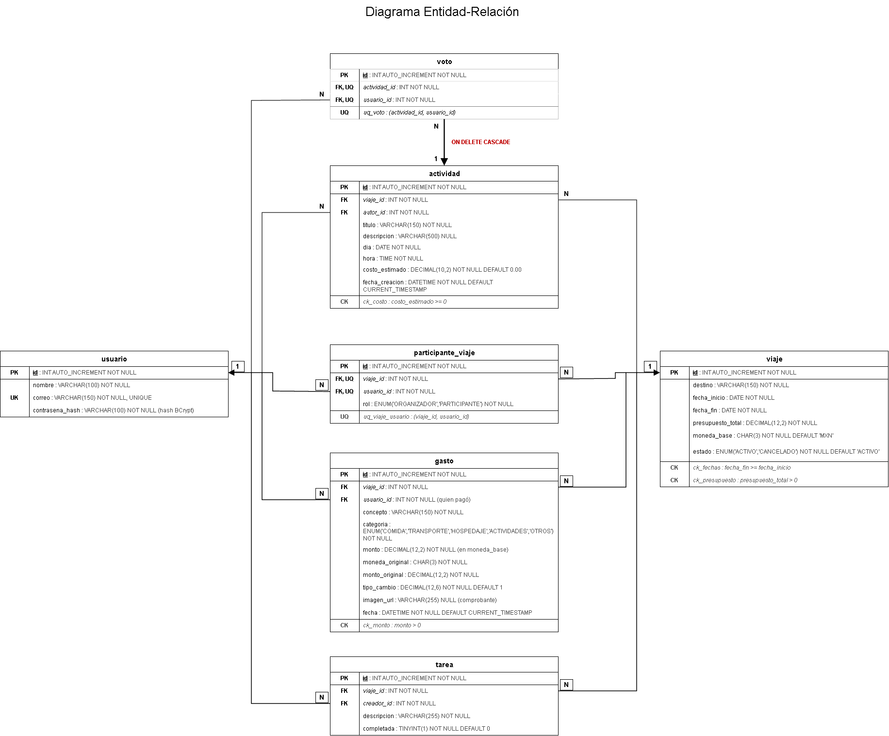

# Diagrama Entidad-Relación

Autora: Dana Carmona Santamaria

Este diagrama muestra cómo se guardan los datos del sistema en MySQL. Tiene 7 tablas. Cada cuadro es una tabla y cada flecha sale de la tabla que guarda la llave foránea y apunta a la tabla de la que depende.

## Cómo leerlo

| Símbolo | Significa                                                              |
| ------- | ---------------------------------------------------------------------- |
| `PK`    | Llave primaria: el `id` que identifica cada fila                       |
| `FK`    | Llave foránea: apunta al `id` de otra tabla                            |
| `UK`    | Valor único: no se puede repetir                                       |
| `UQ`    | Único compuesto: no se puede repetir la combinación de dos columnas    |
| `CK`    | Regla que deben cumplir los valores (por ejemplo, el monto mayor a 0)  |
| `1`, `N`| Un registro del lado `1` se relaciona con muchos del lado `N`          |

Todos los `id` son números enteros (`INT`) que aumentan solos.

## Las 7 tablas

| Tabla                | Qué guarda                                                                  |
| -------------------- | --------------------------------------------------------------------------- |
| `usuario`            | Las personas registradas. El correo es único y la contraseña se guarda como hash, no en texto normal |
| `viaje`              | Destino, fechas, presupuesto, moneda base y estado (`ACTIVO` o `CANCELADO`) |
| `participante_viaje` | Quién está en cada viaje y su rol (`ORGANIZADOR` o `PARTICIPANTE`)          |
| `actividad`          | Lo que se propone hacer en el viaje: título, día, hora y costo estimado     |
| `voto`               | El voto de una persona a una actividad                                      |
| `gasto`              | Lo que se pagó: concepto, categoría, monto, moneda original y tipo de cambio |
| `tarea`              | Los pendientes del viaje y si ya están completados                          |

## Relaciones

Todas las relaciones son de uno a muchos (1 a N):

| Un...       | puede tener muchos...                                                    |
| ----------- | ------------------------------------------------------------------------ |
| `usuario`   | participaciones, actividades, votos, gastos y tareas                     |
| `viaje`     | participantes, actividades, gastos y tareas                              |
| `actividad` | votos                                                                    |

Un usuario puede estar en muchos viajes y un viaje tiene muchos usuarios (relación de muchos a muchos). Se resuelve con la tabla `participante_viaje`. Con los votos pasa igual: `voto` une a `usuario` con `actividad`.

## Reglas 

- Una persona no puede estar dos veces en el mismo viaje (`uq_viaje_usuario`).
- Una persona solo puede votar una vez por actividad (`uq_voto`).
- **Al borrar una actividad se borran sus votos** (`ON DELETE CASCADE`, la flecha en rojo).
- **Al quitar a alguien de un viaje no se borran sus gastos**, porque `gasto` apunta a `usuario` y no a `participante_viaje`.
- Un viaje no se borra: se cancela con el estado `CANCELADO`.
- En las demás relaciones no se puede borrar un registro si otro depende de él (`RESTRICT`).
- El dinero se guarda así: `monto = monto_original × tipo_cambio`, en la moneda base del viaje.
- Las reglas `CK` piden que la fecha de fin no sea antes de la de inicio, que presupuesto y monto sean mayores a 0 y que el costo estimado no sea negativo.