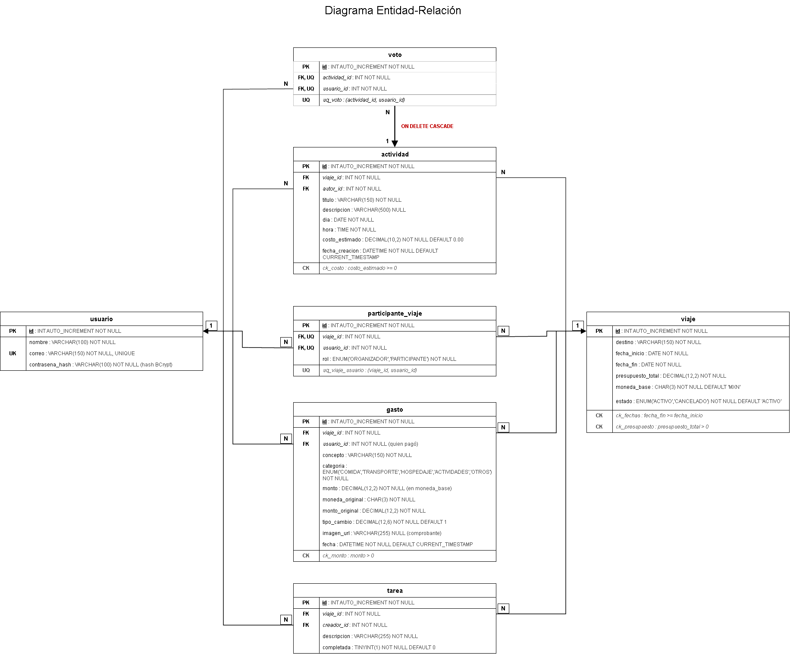

# Evidencias del proyecto

Capturas ordenadas por tema. Cada una se nombra según lo que demuestra. Salvo que se indique otra cosa, las capturas se tomaron en WSL (Ubuntu) con la aplicación en `http://localhost:8081`. La prueba en otro WSL usó el puerto 8080, el que indica el README.

## 01. Instalación y versiones

| Captura | Qué demuestra |
| :--- | :--- |
| [versiones-java-maven-mysql-git-wsl](01-instalacion/versiones-java-maven-mysql-git-wsl.png) | Java 17, Maven 3.9.12, MySQL 8.4 y Git 2.53 instalados en WSL. |

## 02. Backend corriendo desde la terminal

| Captura | Qué demuestra |
| :--- | :--- |
| [mvnw-test-inicio](02-backend/mvnw-test-inicio.png) | Inicio de `./mvnw test`. |
| [mvnw-test-resultado-build-success](02-backend/mvnw-test-resultado-build-success.png) | 13 pruebas ejecutadas, 0 fallas y `BUILD SUCCESS`. |
| [arranque-spring-boot-banner-puerto-8081-conexion-mysql](02-backend/arranque-spring-boot-banner-puerto-8081-conexion-mysql.png) | Spring Boot 3.2.5 arrancando con Java 17, Tomcat en el puerto 8081 y conexión a MySQL (HikariPool). |
| [arranque-spring-boot-run-parcial](02-backend/arranque-spring-boot-run-parcial.png) | `./mvnw spring-boot:run` en la fase de compilación. |

## 03. Conexión a MySQL

| Captura | Qué demuestra |
| :--- | :--- |
| [show-tables-7-tablas](03-mysql/show-tables-7-tablas.png) | `SHOW TABLES` con las 7 tablas del sistema. |
| [select-usuario-viaje-voto-gasto](03-mysql/select-usuario-viaje-voto-gasto.png) | Consultas a `usuario`, `viaje`, `voto` y `gasto` con los datos de prueba y los votos y gastos nuevos. |

## 04. Vistas principales

| Captura | Qué demuestra |
| :--- | :--- |
| [login](04-vistas/login.png) | Pantalla de inicio de sesión. |
| [lista-de-viajes](04-vistas/lista-de-viajes.png) | Lista de viajes con filtros por destino y rol. |
| [crear-viaje](04-vistas/crear-viaje.png) | Formulario para planear un viaje. |
| [detalle-encabezado-participantes-presupuesto](04-vistas/detalle-encabezado-participantes-presupuesto.png) | Detalle del viaje: encabezado, participantes y presupuesto. |
| [detalle-itinerario-votacion-mas-votada-balance](04-vistas/detalle-itinerario-votacion-mas-votada-balance.png) | Itinerario por días con botones de voto, la insignia "Más votada", el presupuesto y el balance del grupo. |
| [detalle-gastos-comprobante-checklist](04-vistas/detalle-gastos-comprobante-checklist.png) | Formulario de gastos con comprobante opcional, lista de gastos y checklist del viaje. |
| [exportar-pdf-descarga](04-vistas/exportar-pdf-descarga.png) | Descarga de `itinerario-Oaxaca-Oaxaca.pdf`. |

## 05. Votación y gasto en vivo (pestaña Network)

| Captura | Qué demuestra |
| :--- | :--- |
| [votacion-network-post-201-y-recarga-detalle](05-en-vivo/votacion-network-post-201-y-recarga-detalle.png) | Un voto: la petición `votos` (201) la lanza `votos.js` y después se vuelve a pedir el detalle, el presupuesto y el balance. |
| [votacion-network-cambio-mas-votada-201-200](05-en-vivo/votacion-network-cambio-mas-votada-201-200.png) | Varios votos y la insignia "Más votada" cambiando de actividad sin recargar la página. Un voto devuelve 201 y quitarlo devuelve 200. |
| [votacion-network-respuesta-json](05-en-vivo/votacion-network-respuesta-json.png) | Respuesta de la API con `actividadId`, `totalVotos` y `votadaPorMi`. |
| [votacion-network-status-200](05-en-vivo/votacion-network-status-200.png) | La petición `votos` con estado 200 y `votos.js:39` como iniciador. |
| [gasto-network-status-201](05-en-vivo/gasto-network-status-201.png) | `POST /api/gastos` con estado 201 Created. |
| [gasto-network-respuesta-json](05-en-vivo/gasto-network-respuesta-json.png) | Respuesta con el gasto creado y el `totalGastado`, junto a la lista de peticiones que actualizan presupuesto y balance. |
| [error-404-viaje-no-encontrado-network](05-en-vivo/error-404-viaje-no-encontrado-network.png) | Caso de error: `GET /api/viajes/999999` devuelve 404 y la pantalla muestra "Viaje no encontrado". |

## 06. Git y GitHub

| Captura | Qué demuestra |
| :--- | :--- |
| [git-log-graph-parte-1](06-git/git-log-graph-parte-1.png) | `git log --oneline --graph --all --decorate`, parte 1: commits recientes (votación, participantes, README, reportes), la rama `main` alineada con `origin/main` y las etiquetas de entrega `V3` y `V4`. |
| [git-log-graph-parte-2](06-git/git-log-graph-parte-2.png) | Parte 2 del historial: commits de `HU-14`, `HU-16`, `HU-21` y `HU-22`, edición y eliminación de actividades, gestión de participantes y reportes. |
| [git-log-graph-parte-3](06-git/git-log-graph-parte-3.png) | Parte 3 del historial: estructura inicial del proyecto, base de datos, autenticación, wireframes y catálogo de endpoints, con la etiqueta `V1`. |
| [git-shortlog-commits-por-integrante](06-git/git-shortlog-commits-por-integrante.png) | `git shortlog -sn`: commits de los cinco integrantes. |

Los nombres de usuario de Git corresponden a los integrantes así: `dana044` (Dana), `Citlaly` (Citlaly), `AMendozaVas` (Alfonso), `stephanieePrieto` y `StephanieePrieto` (Stephanie, con dos grafías del mismo usuario) y `begotrujano` (Diego).

El historial se trabajó sobre la rama `main`, con integraciones (`Merge branch 'main'`) entre los integrantes y etiquetas `V1` a `V4` que marcan las entregas. En este historial no hay ramas `feature/hu-XX`, por lo que no se incluyen capturas de ellas.

## 07. Ejecución en otro WSL

Prueba hecha por Alfonso en una distribución Ubuntu 22.04 distinta a la de desarrollo (usuario `prueba`, Maven 3.6.3, MySQL 8.0.46), con el repositorio clonado desde GitHub y siguiendo solo el README. La aplicación arrancó en el puerto 8080.

| Captura | Qué demuestra |
| :--- | :--- |
| [01-git-clone-y-ls](07-otro-wsl/01-git-clone-y-ls.jpeg) | Clonación del repositorio. |
| [02-versiones-java-maven-mysql-git](07-otro-wsl/02-versiones-java-maven-mysql-git.jpeg) | Versiones instaladas en la máquina limpia. |
| [03-mysql-show-tables-y-conteo-usuarios](07-otro-wsl/03-mysql-show-tables-y-conteo-usuarios.jpeg) | Las 7 tablas creadas y 2 usuarios de prueba. |
| [04-arranque-spring-boot-started-puerto-8080](07-otro-wsl/04-arranque-spring-boot-started-puerto-8080.jpeg) | `Started BitacoraViajesApplication` en el puerto 8080. |
| [05-login-ana](07-otro-wsl/05-login-ana.jpeg) | Inicio de sesión con un usuario de prueba. |
| [06-lista-de-viajes](07-otro-wsl/06-lista-de-viajes.jpeg) | Lista de viajes. |
| [07-detalle-encabezado-participantes](07-otro-wsl/07-detalle-encabezado-participantes.jpeg) | Detalle del viaje y participantes. |
| [08-detalle-itinerario-votos-balance](07-otro-wsl/08-detalle-itinerario-votos-balance.jpeg) | Itinerario con votos, presupuesto y balance. |
| [09-gasto-registrado](07-otro-wsl/09-gasto-registrado.jpeg) | Gasto registrado desde el navegador. |

Los datos de la captura 08 (gastado $5,025) son anteriores al gasto de la captura 09 ($350); por eso la captura 07, tomada después, muestra $5,375.

### Problemas del README encontrados y corregidos

El proyecto corre en una distribución limpia siguiendo el README, pero el README tenía tres problemas que ya se corrigieron:

1. La instalación de MySQL falla si otra distribución de WSL tiene MySQL encendido, porque comparten el mismo puerto (3306). Se agregó el caso a "Problemas comunes".
2. "Configuración local" pedía entrar a la carpeta del repositorio antes de explicar cómo clonarlo. La clonación se pasó a una sección propia antes de la configuración.
3. La aplicación no puede crear las tablas `actividad` y `gasto` en MySQL 8. Ahora el README indica cargar `database/esquema.sql` antes del primer arranque.

## Diagrama entidad-relación

